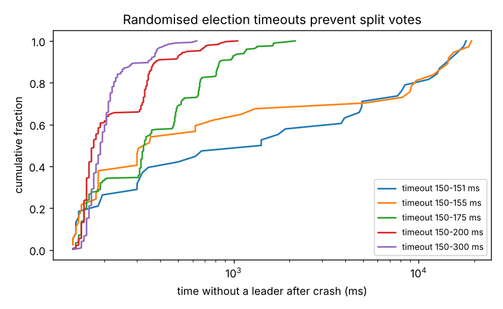

# Raft Consensus Key-Value Store — with Chaos Testing

A from-scratch implementation of **Raft** (Ongaro & Ousterhout, *In Search of an Understandable Consensus Algorithm*,
USENIX ATC 2014) replicating a key-value store across 5 servers: leader election with randomised timeouts, log replication
with consistency checks and conflict truncation, commit rules (including the "only count current-term entries" rule of
Figure 8), crash/restart from persisted state, and client redirects and retries.

The cluster runs on a **deterministic discrete-event simulator** (message delays, drops, network partitions, crashes), so
every run is reproducible from its seed and faults can be injected precisely. A checker verifies Raft's safety properties
after every run: election safety, log matching, state-machine safety, and that no write acknowledged to a client is lost.

## Results

**Chaos testing:** 300 randomised runs, each with 300 client writes under random crashes, restarts, partitions and 5%
message loss → **0 safety violations** across 85,975 acknowledged writes.

**The checks catch real bugs:** with one deliberate bug switched on — granting votes without the "candidate's log is at
least as up to date" check — the same harness finds violations (lost acknowledged writes, divergent state machines) in
**179 of 300 runs**, starting from the very first run. A second injected bug (committing old-term entries by counting
replicas, the Figure 8 scenario) was **not** triggered by random chaos in 300 runs: it needs a specific interleaving, which
is why targeted scenario tests are still needed.

**Leader election after a leader crash** (300 trials per row; timers checked every 10 ms)

| Election timeout | No leader within 20 s | Median time to new leader | p95 |
|---|---|---|---|
| 150–151 ms | 152/300 initially, 110 after crash | 1,410 ms | 16.5 s |
| 150–175 ms | 0 | 328 ms | 1,156 ms |
| 150–200 ms | 0 | 175 ms | 565 ms |
| **150–300 ms** | 0 | 190 ms | **380 ms** |

Without enough randomness, candidates time out together, split the vote and repeat — the effect shown in the paper's
Figure 16 (exaggerated here by the 10 ms timer granularity).

**Writes under message loss** (500 writes, one every 20 ms): every write is acknowledged at up to 30% loss; median commit
latency rises from 19.6 ms to 27.6 ms and p99 from 25.9 ms to 55.8 ms.



Full tables: [`results/summary.md`](results/summary.md)

## Code
| File | Content |
|---|---|
| `src/raft/node.py` | Raft server state machine (follower / candidate / leader), RequestVote and AppendEntries handlers, commit and apply |
| `src/raft/sim.py` | Event-driven network and fault simulator, client with redirect and retry |
| `src/raft/checks.py` | Safety-property checker |
| `src/raft/chaos.py` | Randomised fault schedules |
| `tests/test_raft.py` | Election, replication, leader crash, minority partition, restart recovery, chaos runs |

## Run
```bash
pip install -r requirements.txt
python -m unittest discover -s tests -v
python scripts/run_experiments.py      # ~1 min
```
